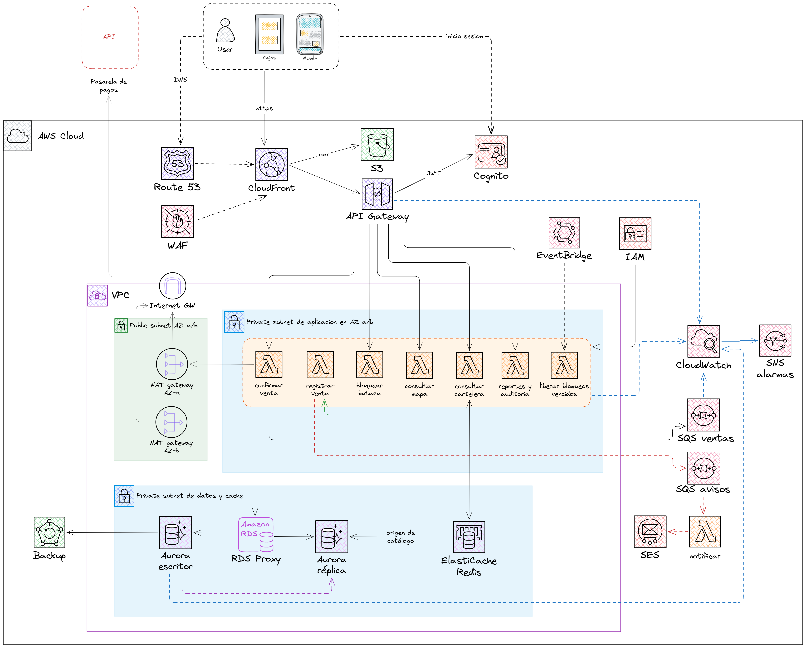

# CineAndes

Infraestructura en AWS para el sistema de venta de entradas de CineAndes, una cadena de cines de Trujillo que está pasando de 1 a 4 sedes en La Libertad. El sistema se usa desde la web, la app móvil y las cajas de cada sede.

Este repositorio es parte del curso ISIA-107 Infraestructura como Código (UPAO). Solo contiene la infraestructura: el software del sistema no se construye en el curso, así que las Lambdas llevan un código base de arranque.

## Arquitectura



Es serverless, está en la región `us-east-2` y usa dos zonas de disponibilidad. Los atributos de calidad que priorizamos son disponibilidad, confiabilidad y escalabilidad.

1. Los usuarios (clientes en la web y la app móvil, y las cajas de las sedes) entran por **Route 53** y **CloudFront**. CloudFront entrega la web desde **S3** y tiene un **WAF** delante.
2. El inicio de sesión se hace con **Cognito**. **API Gateway** valida el token de cada petición.
3. API Gateway invoca a las **8 Lambdas**: confirmar venta, registrar venta, bloquear butaca, consultar mapa, consultar cartelera, reportes y auditoría, liberar bloqueos vencidos y notificar. Cada una tiene su rol de **IAM**.
4. Las Lambdas viven en subredes privadas de una **VPC** (`10.0.0.0/16`). Para salir a internet, por ejemplo a la pasarela de pagos externa, usan un **NAT Gateway** por zona.
5. Los datos están en subredes privadas sin ruta a internet. **Aurora MySQL** tiene el escritor en una zona y la réplica en la otra, con **RDS Proxy** delante. **ElastiCache Redis** guarda el catálogo de la cartelera.
6. Las ventas pasan por colas **SQS** (con una cola de fallidos para ventas). Los avisos al cliente los envía la Lambda notificar por **SES**. **EventBridge** dispara cada minuto la liberación de bloqueos vencidos.
7. **CloudWatch** vigila la API, las Lambdas, Aurora y las colas, y avisa al equipo técnico por **SNS**. **AWS Backup** respalda Aurora cada semana y guarda las copias por un año.

## Estructura de carpetas

```
CINEANDES/
├── .github/workflows/   pipelines de validación, despliegue y destrucción
├── docs/
│   ├── arquitectura.png diagrama de la arquitectura
│   └── iam/             política de permisos del rol del pipeline
├── lambdas/
│   └── comun/           código base de las funciones Lambda
└── terraform/
    ├── providers.tf     proveedor de AWS y etiquetas
    ├── variables.tf     variables globales
    ├── backend.tf       backend remoto en S3
    ├── main.tf          llamado a los módulos
    └── modules/         un módulo por cada parte de la arquitectura
```

## Módulos

| Módulo | Qué crea | Responsable |
|---|---|---|
| network | VPC, subredes (públicas, de aplicación y de datos), NAT, rutas y grupos de seguridad | Yessi |
| compute | Roles, las 8 Lambdas, grupos de registros, disparadores de las colas y EventBridge | Yessi |
| data | Aurora MySQL, RDS Proxy, Secrets Manager y Redis | Gabriel |
| messaging | Colas SQS con su cola de fallidos e identidad de SES | Yengle |
| edge | S3 de la web, CloudFront, WAF, Cognito, API Gateway y Route 53 | Said |
| operations | Alarmas de CloudWatch, tema SNS y plan de AWS Backup | Chars |

Cada módulo recibe lo que necesita de otros módulos por variables desde `terraform/main.tf`. Ninguno busca ni crea recursos que pertenezcan a otro.